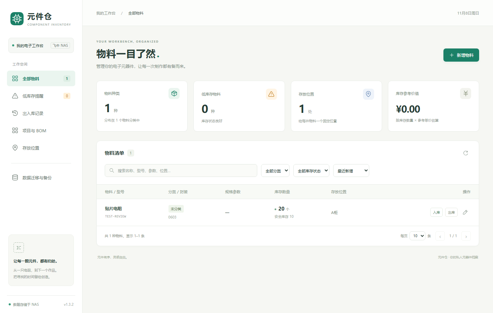
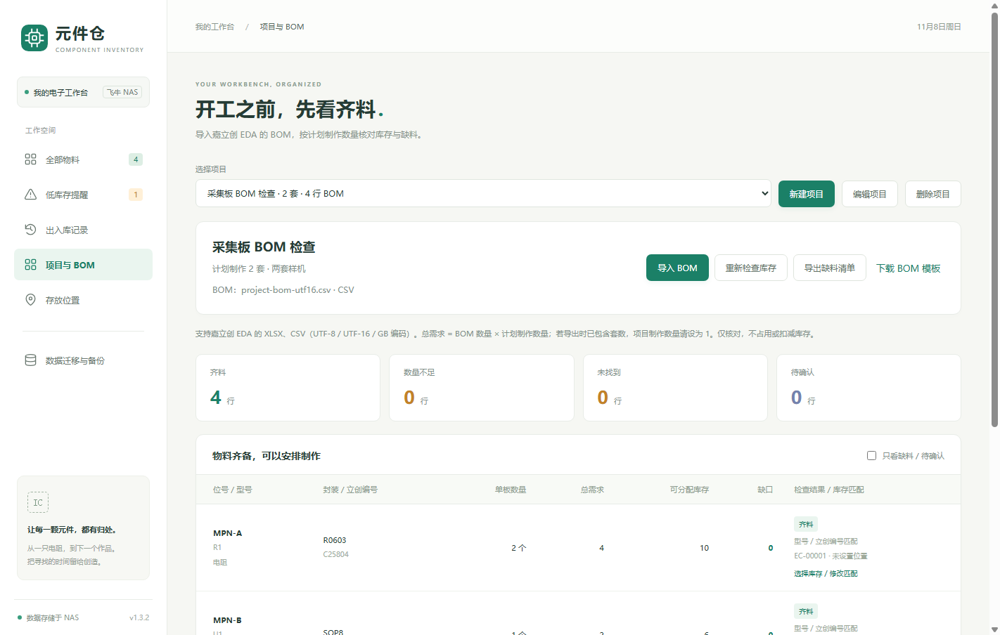
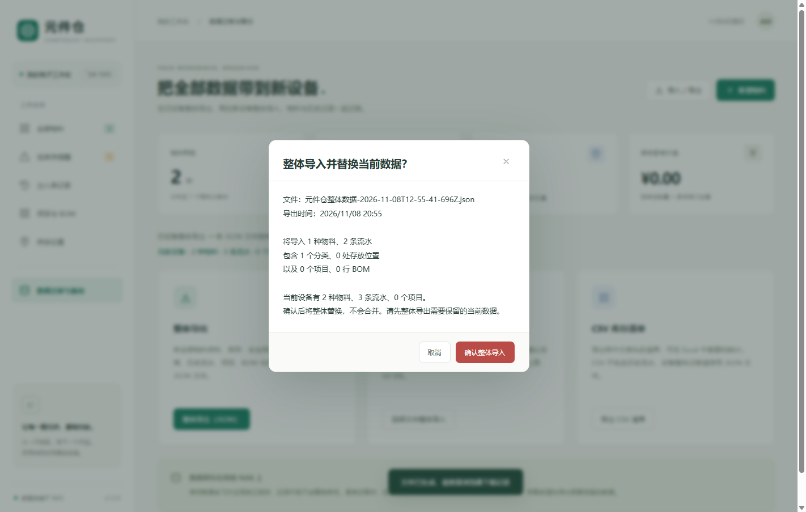

# 元件仓 · electronics-inventory

[](LICENSE)
[](https://www.python.org/)
[](https://www.fnnas.com/)
[](fnos/manifest)

面向飞牛 **fnOS Native** 的中文电子元器件物料管理应用。使用 **Python 标准库**提供服务，**SQLite** 保存数据，浏览器作为操作界面；应用代码无需安装第三方 Python 依赖，运行在飞牛提供的 `python312` 运行时上。

<p align="center">
  
</p>

## 功能概览

| 模块 | 说明 |
| --- | --- |
| 物料档案 | 名称、型号、编号、分类、封装、规格、制造商、供应商、立创编号、数据手册、备注 |
| 库存管理 | 入库 / 出库 / 盘点、安全库存、参考单价；事务保护，阻止超量出库 |
| 库存流水 | 记录操作前后数量、增减量、时间与备注 |
| 低库存提醒 | 零库存或低于安全库存纳入提醒 |
| 搜索筛选 | 多字段搜索；按分类、库存状态筛选；排序与分页 |
| 位置管理 | 按存放位置自动归组汇总 |
| 项目与 BOM | 导入嘉立创 / 立创 EDA 的 XLSX / CSV，齐料检查、手动匹配、缺料导出 |
| 数据迁移 | 完整 JSON 导入导出（物料、流水、项目、BOM）；另支持中文 CSV 清单 |

<p align="center">
  
  &nbsp;
  
</p>

## 快速开始（飞牛 Native）

安装包：发布页或自行构建得到的 `electronics-inventory.fpk`。

要求：国内版 **fnOS 1.1.3100 或以上**，并能从应用中心安装 `python312` 运行时。包内无架构相关二进制，声明支持 x86 与 ARM；实际设备兼容性仍需安装验证。

1. 在飞牛应用中心使用「手动安装」选择 `.fpk`，按提示准备 Python 3.12；或在 NAS 上执行：
   ```bash
   appcenter-cli install-fpk electronics-inventory.fpk
   ```
2. 安装并启动「元件仓」，使用 **NAS 管理员账号**从飞牛桌面打开（普通账号无访问权限）。
3. 页面经统一网关 `/app/electronics-inventory/` 访问；后端只监听应用 Unix Socket，不开放独立 TCP 端口。
4. 更换 NAS 时，通过「数据迁移与备份 → 整体导出（JSON）」导出，再在新设备整体导入。

数据库：`${TRIM_PKGVAR}/inventory.db`（通常为 `/var/apps/electronics-inventory/var/inventory.db`）；日志同目录 `app.log`。安装文件与运行数据分离，升级不覆盖库存。

<p align="center">
  
</p>

## 重新打包

从 [飞牛官方 fnpack 文档](https://developer.fnnas.com/docs/cli/fnpack/) 下载对应开发机系统的工具。例如 Windows 版放到 `.tools/fnpack.exe`，然后执行：

```powershell
python scripts/build_fnos.py
```

指定工具路径：

```powershell
python scripts/build_fnos.py --fnpack C:\tools\fnpack.exe
```

Linux：

```bash
python3 scripts/build_fnos.py --fnpack /path/to/fnpack
```

只准备应用目录而不打包：`--prepare-only`，输出在 `.build/fnos/electronics-inventory/`。

构建脚本只复制明确列出的程序和前端文件，不复制 `data/`、缓存、测试或工具。官方 `fnpack` 完成后，脚本会规范包内 Linux 文件权限（生命周期脚本 `0755`，普通文件 `0644`），并重新计算 FPK 载荷校验值，避免 Windows 打包丢失可执行权限。

## 使用说明

### 日常库存

1. 在「全部物料」点击「新增物料」，填写名称、型号、数量和存放位置（如 `A柜 / 第2层 / 03格`）。编号留空时自动生成 `EC-00001` 格式。
2. 采购到货点「入库」，项目领用点「出库」。
3. 进入物料详情可查看流水或「盘点」：填写**实际剩余总数**，系统计算差额。
4. 编辑资料不直接改库存；只有零库存物料可删除，删除后流水保留。
5. 定期在「数据迁移与备份」整体导出 JSON。CSV 仅作清单；设备迁移必须用 JSON。

首次启动为空库。相同型号可建多份档案（如位置不同）；物料编号全局唯一（不区分大小写）。

### 项目备料与嘉立创 EDA BOM

1. 「项目与 BOM」→「新建项目」，填写名称与计划制作数量。总需求 = **BOM 行数量 × 计划制作数量**；若 EDA 导出数量已含套数，计划数量请设为 `1`。
2. 从嘉立创 / 立创 EDA 导出 BOM（XLSX 或 CSV）。常用列：`Manufacturer Part`、`Quantity`、`Footprint`、`Designator`、`Supplier Part`（中文表头也可识别）。
3. 「导入 BOM」后查看字段识别与预览；确认会替换该项目原 BOM，不修改库存。
4. 检查齐料 / 缺料 / 待确认；可下载缺料 CSV。检查**不会占用或扣减库存**。
5. 无法自动匹配时，可手动指定库存档案。

文件限制：**5 MB、10000 行、128 列**。CSV 支持 UTF-8（含 BOM）、UTF-16、GB18030；XLSX 支持共享 / 内联字符串。旧 `.xls` 请另存为 `.xlsx`。

匹配要点：优先立创 / 供应商编号，其次精确型号；封装会核对（如 `R0603` ↔ `0603`）；同规格多位置可合计；不同单位不自动换算。

参考：[嘉立创 EDA 专业版导出 BOM](https://prodocs.lceda.cn/cn/schematic/export-bill-of-materials-bom/index.html)。

### 更换设备

1. 旧设备「整体导出（JSON）」。
2. 新设备安装后「选择文件整体导入」→ 预览校验 →「确认整体导入」。
3. 导入会**替换**当前全部数据，不会合并。

整体 JSON 含物料、库存、流水、项目、BOM、手动匹配与自动编号序列。1.2.0+ 使用第 2 版格式；旧版第 1 版 JSON 仍可导入。

## 安全与权限

- 飞牛网关校验 NAS 登录态；后端再检查 `X-Trim-Userid` / `X-Trim-Isadmin`，仅管理员可访问。
- 应用无独立登录体系；以独立包用户运行，不请求 root 或共享文件夹权限。
- 1.3.0 起页面携带请求校验令牌，兼容网关改写 Host 等情况；令牌不替代管理员权限检查。

## 数据与备份

- 运行中请勿单独复制 `.db` 文件；请用界面完整 JSON 备份。
- 停止应用后可备份 `var` 目录；跨设备推荐 JSON。
- 整体导入 JSON 上限 **64 MB**；其他 JSON 请求上限 **10 MB**。

## 项目结构

```text
electronics-inventory/
├── app.py                 # HTTP API、SQLite、业务规则
├── bom.py                 # EDA CSV/XLSX 解析与库存匹配
├── static/                # 前端界面
├── tests/                 # 单元与集成测试
├── fnos/                  # 飞牛元数据、权限、生命周期脚本
├── scripts/build_fnos.py  # 打包脚本
├── docs/screenshots/      # README 截图
├── dist/                  # 构建输出（已忽略）
└── data/                  # 本地开发数据（已忽略）
```

## 开发与验证

```bash
python -m unittest discover -s tests -v
node --check static/app.js
```

测试使用临时数据库，不会修改实际库存。开发机不支持 Unix Socket 时，相关用例会自动跳过。

在 NAS 上建议验证：管理员可开页、普通账号不可访问；出入库与盘点；JSON 导出导入；停启后数据仍在；查看 `app.log`。

参考：[Native 应用案例](https://developer.fnnas.com/docs/examples/native/)、[统一网关](https://developer.fnnas.com/docs/core-concepts/gateway-registration/)、[运行时环境](https://developer.fnnas.com/docs/core-concepts/runtime/)。

## 许可证

本项目以 [MIT License](LICENSE) 开源。
